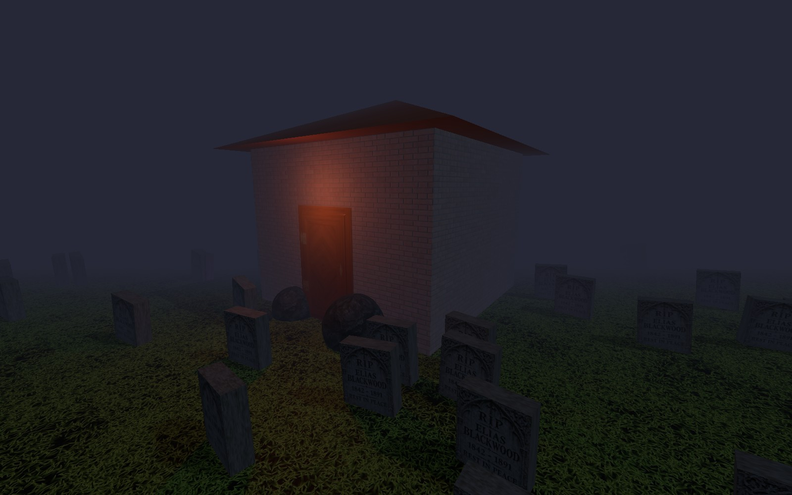
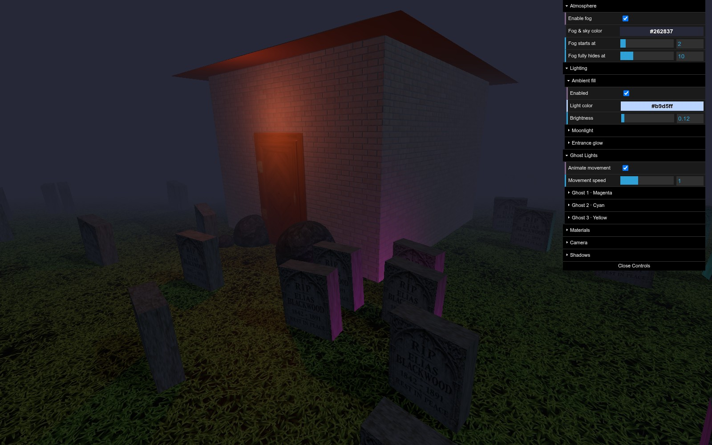
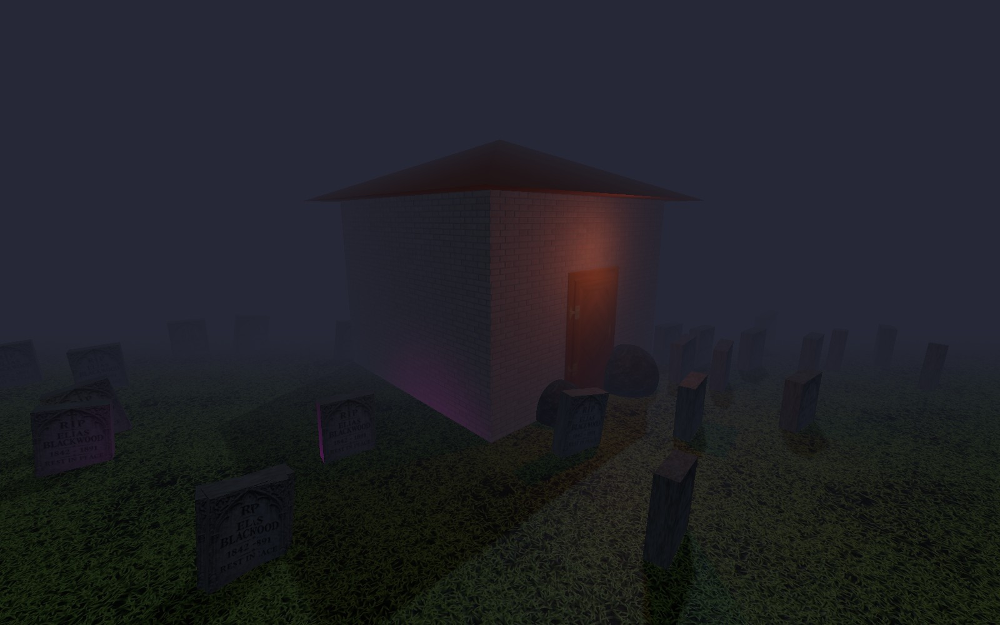
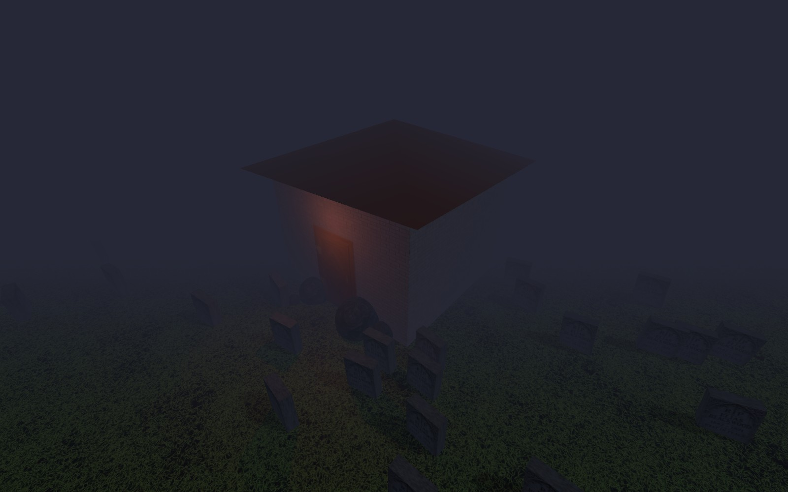
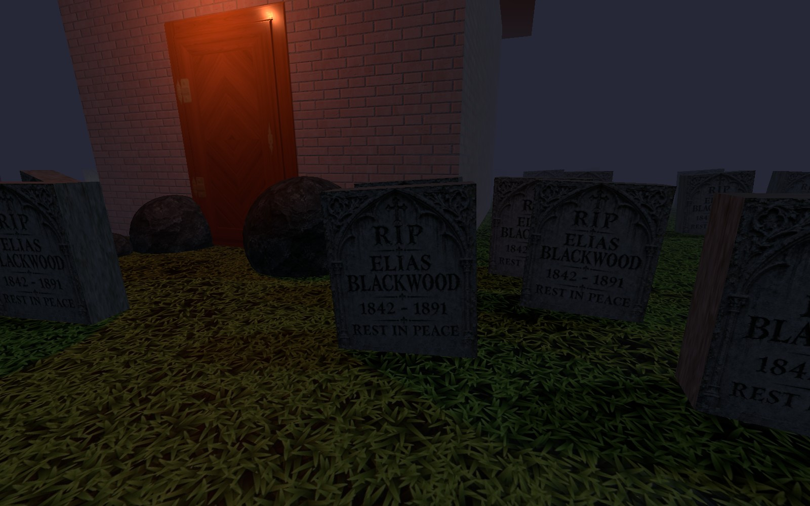
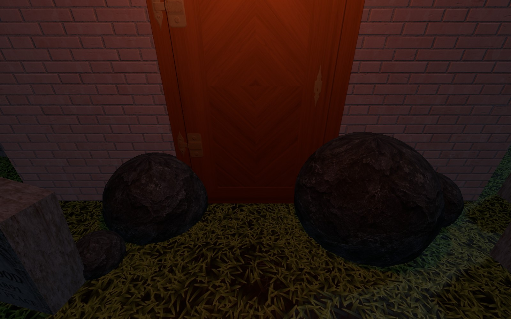
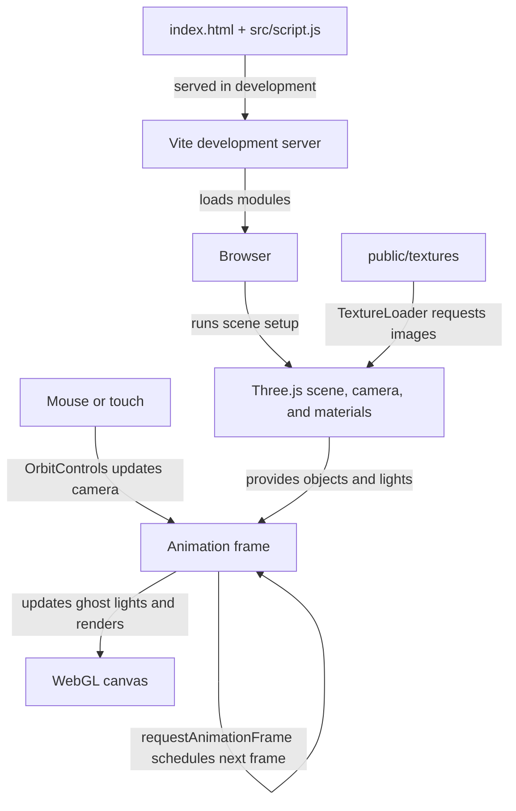

# Scary House

A browser-based haunted-house scene built with **Three.js**, **Vite**, and **dat.GUI**. Explore a foggy cemetery with a brick house, a glowing entrance, gothic gravestones, weathered rocks, and three moving colored lights.

**[Open the live interactive scene](https://ajramoslem99.github.io/scary_house/)**

This is an interactive graphics learning project. There is no backend, account setup, game objective, or collision system.



## Run locally

### Requirements

- **Node.js 22.12 or newer** is recommended. The installed Vite version also supports Node.js 20.19 and newer within the Node 20 release line.
- **npm**, included with Node.js.
- A modern browser with WebGL 2 support. Hardware acceleration is recommended.

The project was checked with Node.js 22.17.0. No environment variables, API keys, database, or external service are required.

### Install and start

From the project directory:

```bash
npm ci
npm run dev
```

Open the local URL printed by Vite, usually **http://localhost:5173**. If that port is busy, Vite may choose another one. Leave the terminal running while you explore; press `Ctrl+C` to stop the server.

`npm ci` installs the dependency versions recorded in `package-lock.json`. If you intentionally change dependencies, use `npm install` to update the lockfile.

Use the Vite server rather than opening `index.html` directly: the JavaScript uses module imports, and textures are requested from absolute `/textures/...` URLs.

## Explore the scene

| Action | Mouse / trackpad | Touch |
| --- | --- | --- |
| Orbit around the current target | Left-button drag | One-finger drag |
| Zoom in or out | Scroll wheel / trackpad scroll, or middle-button drag | Two-finger pinch |
| Pan the camera target | Right-button drag | Two-finger drag |

The camera uses `OrbitControls` with damping, so movement eases to a stop. There are no keyboard movement controls or collision boundaries. You can move through objects and below the floor.

The **dat.GUI panel in the upper-right corner** groups experiments into named folders. Click a folder to expand or collapse it.

| Folder | Available controls |
| --- | --- |
| **Atmosphere** | Enable fog, change fog and sky color together, adjust where fog starts and fully hides objects |
| **Lighting** | Ambient fill, moonlight, and entrance glow: enable each light, change its color and brightness; reposition moonlight; change entrance light range |
| **Ghost Lights** | Pause/resume movement, adjust animation speed, and change each ghost light's color, brightness, visibility, and range |
| **Materials** | Gravestone and rock tints, surface roughness, stone grain and carving depth, grass and roof roughness |
| **Camera** | Field of view, smooth movement, automatic orbit and its speed, and reset camera view |
| **Shadows** | Enable all shadows or individually toggle moonlight, entrance, and ghost shadows |

Fog distances automatically keep the end beyond the start. Changing a point light's range also updates its shadow-camera reach. Pausing ghost movement preserves its current position; resuming or changing speed continues smoothly. A movement speed of zero also holds the lights still. These controls pause the lights' movement, not rendering or camera interaction.

**Reset camera view** restores the starting camera position, target, zoom, and field of view; the other experiment settings remain as chosen. Turn off **Auto orbit** if you want the reset view to stay still. Use **Close Controls** to collapse the panel. Settings affect the current session and reset when you reload.

The scene is intentionally dim. Move closer to read the gravestone lettering, or increase **Lighting → Ambient fill → Brightness**. Try pausing the ghosts and adjusting their colors to compare lighting on the same surface. Reloading generates a new random grave arrangement.



## Scene gallery

These screenshots show the running WebGL scene from five camera positions. For a consistent gallery, the capture session used one repeatable grave arrangement and paused the moving lights at the same animation time. The GUI was hidden for the images; the scene's lighting and fog settings were retained. The application itself still uses random placement and continuous animation.

### Front-left view



The opposite side shows how the house, grave ring, and entrance sit together.

### Elevated view



The higher angle shows the roof and the cemetery layout. Distant objects fade into the fog.

### Gothic gravestone detail



The broad faces carry a carved gothic arch, cross, and the inscription **RIP / ELIAS BLACKWOOD / 1842–1891 / REST IN PEACE**. The sides, top, and bottom use plain weathered stone. All graves currently share this inscription.

### Entrance and rocks



The four spheres beside the entrance share a fractured rock material. Their original `bush` variable names remain in the code.

## Technology and project structure

| Dependency | Role |
| --- | --- |
| Three.js | Scene graph, geometry, materials, lights, camera, and WebGL rendering |
| OrbitControls | Orbiting, zooming, and panning the camera |
| Vite | Development server, module handling, and production bundling |
| dat.GUI | Live light controls |

`OrbitControls` is included with Three.js; it is not a separate installed dependency.

```text
scary_house/
├── index.html                 # Canvas and JavaScript entry point
├── package.json               # Dependencies and dev command
├── package-lock.json          # Locked dependency versions
├── vite.config.mjs            # Relative asset paths for subdirectory hosting
├── .github/workflows/deploy.yml # Build and deploy to GitHub Pages on main
├── src/
│   ├── script.js              # Entire scene and render loop
│   └── style.css              # Full-window canvas styling
├── public/
│   └── textures/
│       ├── bricks/            # Wall color, AO, normal, roughness
│       ├── door/              # Door color, cutout, depth, and surface maps
│       ├── grass/             # Tiled ground surface maps
│       ├── grave/             # Weathered stone and inscribed face maps
│       ├── rock/              # Fractured rock surface maps
│       └── horror-materials.txt # Generated texture prompts and map notes
└── docs/
    └── screenshots/           # Scene captures embedded in this README
```

The application deliberately keeps scene construction in one file. Its sections run in order: base setup, textures, house and cemetery, lights, viewport sizing, camera, renderer and shadows, then animation.

### Runtime flow



`Vite` serves the entry files; the browser builds the `Three.js scene` and loads its textures. User input updates the camera through `OrbitControls`. Each animation frame moves the ghost lights and renders the scene onto the canvas, then schedules the next frame. This diagram describes development: a production host serves the built files instead of running Vite's development server.

## How the scene works

### House and cemetery

- **House:** a `THREE.Group` containing box-shaped brick walls, a four-sided cone roof, a textured plane for the door, four rock spheres, and the entrance light.
- **Graves:** another group with 50 meshes sharing one `BoxGeometry` and two materials. Each grave receives a random angle, radius between 3 and 9 units, and small random rotations.
- **Floor:** a 20 × 20 plane rotated horizontally. All grass maps repeat 8 × 8 so their surface details stay aligned.

Sharing geometry and materials avoids creating a separate copy for every grave. Each grave remains an individual mesh, so this is not instanced rendering.

### Gothic stone materials

The materials use `MeshStandardMaterial`, which responds to the scene's lights.

| Map / setting | What it contributes |
| --- | --- |
| `map` | Visible surface color and engraved lettering |
| `bumpMap` | Apparent fine depth through lighting; it does not move vertices |
| `roughnessMap` | Variation in how dull or reflective the stone appears |
| `normalMap` | Fine surface orientation detail on the existing brick, grass, and door materials |
| `aoMap` | Authored ambient shading detail |
| `displacementMap` | Actual vertex displacement on the subdivided door plane |
| `alphaMap` | The door's cutout shape |

The grave and rock color maps use `THREE.SRGBColorSpace`; their height and roughness maps remain scalar data. Their height and roughness maps are approximations derived from color luminance, rather than independently scanned physical material maps.

`graveFaceMaterial` clones the existing stone material and replaces its maps. `BoxGeometry` uses this material order:

```js
// right, left, top, bottom, front, back
const graveMaterials = [
  graveMaterial,
  graveMaterial,
  graveMaterial,
  graveMaterial,
  graveFaceMaterial,
  graveFaceMaterial,
];
```

This keeps the inscription on the two broad faces. The face texture is applied once; tiling it would repeat the text. The gothic arch is texture detail on a rectangular mesh, so it does not change the silhouette.

The rock maps repeat twice around each sphere. Generated grave and rock texture prompts are recorded in [horror-materials.txt](public/textures/horror-materials.txt).

### Lighting, fog, and shadows

The scene combines dim blue ambient light, directional moonlight, a warm orange entrance light, and three moving point lights colored magenta, cyan, and yellow. The ghost lights are lights only; there are no visible ghost models.

Their horizontal movement uses sine and cosine to make circular or changing-radius paths. Additional sine waves move them vertically. Elapsed time drives the animation rather than a fixed movement increment per frame.

Fog blends objects toward `#262837` between distances 2 and 10 from the camera. The renderer uses the same background color so objects disappear smoothly into the distance.

Shadows are enabled with `PCFShadowMap`. The walls, rocks, and graves cast shadows, and the floor receives them. The entrance and ghost lights use 256 × 256 shadow maps to limit rendering cost.

### Rendering and resizing

Every frame, `tick()` reads the time since the previous frame, updates the camera controls, moves the three ghost lights, renders, and requests another frame. Ghost animation time accumulates only while movement is enabled, multiplied by the chosen speed. Frame time is capped at 0.1 seconds to avoid a large jump after returning to a backgrounded tab. On resize, the application updates the camera aspect ratio, projection matrix, and renderer size. Pixel ratio is capped at 2; grass anisotropy is capped at 8 and the device's supported maximum.

## Make changes without changing the architecture

Edit the existing sections in `src/script.js`; Vite reloads the page after source changes.

| Change | Where to look |
| --- | --- |
| Change the starting view | Camera section: `camera.position.x`, `.y`, and `.z` |
| Change fog density range | Base section: `new THREE.Fog(...)` near the top |
| Add or remove graves | Graves section: the loop's `i < 50` condition |
| Change cemetery spread | Graves section: `3 + Math.random() * 6` |
| Replace the inscription | Textures section: `graveFaceColorTexture` and matching face maps |
| Change apparent carving depth | Graves section: `graveFaceMaterial.bumpScale` |
| Change rocky surface depth | Bushes section: `bushMaterial.bumpScale` |
| Change rock tiling | Textures section: rock maps' `texture.repeat.set(2, 1)` |
| Change light colors or brightness | Lights section |
| Change ghost speed or motion | Animate section: angle multipliers and sine expressions |

Place new images inside `public/textures/` and load them through the existing `textureBase` prefix, for example `` textureLoader.load(`${textureBase}grave/face-color.jpg`) ``. This prefix uses Vite's base URL, so textures resolve both locally and under the GitHub Pages repository path. Do not include `public` in the URL. Keep related color, bump, and roughness maps aligned. Inscribed face images should use the grave's **3:4 width-to-height ratio** to avoid stretching.

## Build and serve a production preview

Use the package scripts to build and preview the production site:

```bash
npm run build
npm run preview
```

The build produces `dist/`, including the bundled JavaScript, CSS, and copied public assets. Open the preview URL printed in the terminal. The preview server is for checking the build locally.

For deployment, upload the **contents of `dist/`** to a static web host. No Node.js process or backend is needed on the production host. Vite's relative base (`./`) and the matching texture prefix support both domain-root and repository-subdirectory hosting. `dist/` is generated and ignored by Git.

### GitHub Pages

Live URL: **https://ajramoslem99.github.io/scary_house/**

The workflow in [deploy.yml](.github/workflows/deploy.yml) publishes the site whenever commits are pushed to `main`. It checks out the source, installs locked dependencies with `npm ci`, builds `dist/`, and deploys that build through GitHub Pages. You can also run it manually using **Actions → Deploy to GitHub Pages → Run workflow**.

The repository's **Settings → Pages → Build and deployment → Source** must be **GitHub Actions**, rather than a branch containing the source files. Vite source files need a build before static hosting can run them. See the [GitHub Pages workflow documentation](https://docs.github.com/en/pages/getting-started-with-github-pages/using-custom-workflows-with-github-pages).

To publish future changes:

```bash
git add <files-you-changed>
git commit -m "Describe your change"
git push origin main
```

Check the repository's Actions tab for deployment progress. A successful workflow updates the same live URL; allow a short delay for the published site to refresh.

To test from another device on your local network:

```bash
npm run dev -- --host 0.0.0.0
```

Open the network URL printed by Vite on that device. Both devices must be able to reach each other, and the host firewall must allow the development port.

## Validation

There is currently no automated test suite or test script. Useful basic checks are:

```bash
node --check src/script.js
npm run build
```

These verify JavaScript syntax and bundling; they do not prove that textures loaded or that the rendered scene looks correct. After material or lighting changes, also check in a browser:

1. The scene renders and the three colored lights move.
2. Orbit, zoom, and pan work; resizing preserves the correct proportions.
3. The GUI changes the intended lights.
4. The gravestone inscriptions appear upright on the broad faces and stone covers the edges.
5. The rocks and grass display their surface textures.
6. The browser console and Network panel show whether any resources failed to load.

The documentation update was checked with a production build and captures of the running scene. The deployment configuration also makes all texture requests use the application's base path, including the corrected door ambient-occlusion image URL.

## Troubleshooting and current limitations

### A door texture request fails

Open the browser's Network panel and check the failed URL. Texture files live under `public/textures/`, while requests use the `textureBase` prefix. In particular, the door ambient-occlusion file is `door/ambientOcclusion.jpg`, not `ambientOcclusion.jpg` at the textures root. Avoid adding a leading slash to new texture paths, since it bypasses the repository path on GitHub Pages.

### The console warns about `THREE.Clock`

The current code uses `THREE.Clock`, which is deprecated in the installed Three.js release. It still drives the animation here. A future maintenance change can migrate the loop to `THREE.Timer`; the warning does not by itself mean the scene failed to render.

### The scene is dark or the letters are hard to read

The lighting and fog deliberately reduce visibility. Zoom in, view a grave more directly, or increase **Lighting → Ambient fill → Brightness**. Small lettering naturally becomes unreadable at a distance.

### The scene is slow

Several shadow-casting point lights are expensive because each point-light shadow requires rendering multiple directions. Try reducing the pixel-ratio cap, disabling selected lights' `castShadow`, or disabling renderer shadows while investigating. Increasing shadow-map resolution improves detail but costs more memory and rendering time.

### Other scope limits

- Grave placement is random and does not prevent graves from overlapping one another.
- All graves share one inscription; there is no individual name or date system.
- Camera movement is unrestricted, with no collision or ground constraints.
- Textures load asynchronously without a loading screen or an error fallback.
- There is no saved scene state or saved GUI configuration.
- A production build currently emits a large-chunk advisory for the Three.js bundle. It is an optimization notice, not a build failure.
